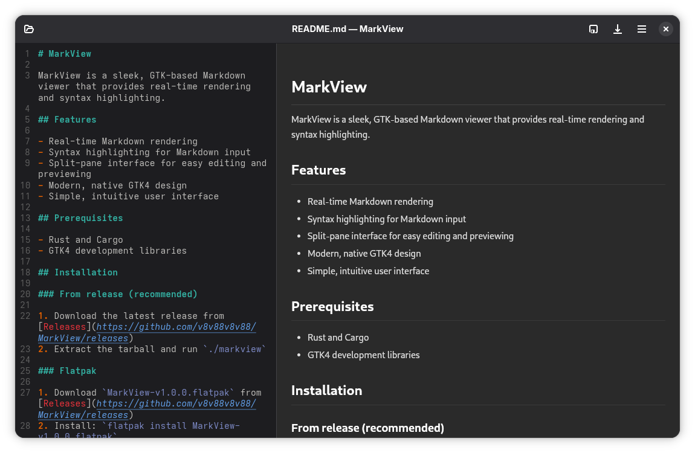

<div align="center">
  
  <h1>MarkView</h1>
  <p>A Markdown editor for GNOME with a live preview.</p>
</div>



Write Markdown on the left and see it rendered on the right as you type. Built with Rust, GTK4 and libadwaita.

## Features

- Live preview rendered with WebKit, updated in place without reloading the page
- Editor and preview scroll together
- Split, preview-only and editor-only layouts (Ctrl+L to switch)
- Editor built on GtkSourceView: 27 color schemes in light and dark, line numbers, word wrap and optional Vim keybindings
- Find in the document (Ctrl+F)
- Export to PDF
- YAML front matter can be shown, hidden or ignored
- Readable line length for the preview, with an adjustable width
- Every keyboard shortcut can be changed in Preferences
- Follows the system light or dark style

## Install

Download the Linux x86_64 tarball from the [latest release](https://github.com/V8V88V8V88/MarkView/releases/latest), extract it and run `./markview`. It needs GTK 4, libadwaita 1.8, GtkSourceView 5 and WebKitGTK 6.0 installed on your system.

## Build from source

You need Rust and the development packages for GTK 4, libadwaita 1.8, GtkSourceView 5 and WebKitGTK 6.0.

```bash
# Fedora
sudo dnf install gtk4-devel libadwaita-devel gtksourceview5-devel webkitgtk6.0-devel

git clone https://github.com/V8V88V8V88/MarkView.git
cd MarkView
cargo run --release
```

## Keyboard shortcuts

| Action | Default |
|---|---|
| Open | Ctrl+O |
| Save / Save As | Ctrl+S / Ctrl+Shift+S |
| Export as PDF | Ctrl+P |
| Find | Ctrl+F |
| Toggle editor | Ctrl+E |
| Switch layout | Ctrl+L |
| Toggle readable line length | Ctrl+R |
| Preferences | Ctrl+, |
| Shortcuts | Ctrl+? |
| Quit | Ctrl+Q |

## License

GPL-2.0. See [LICENSE](LICENSE).
