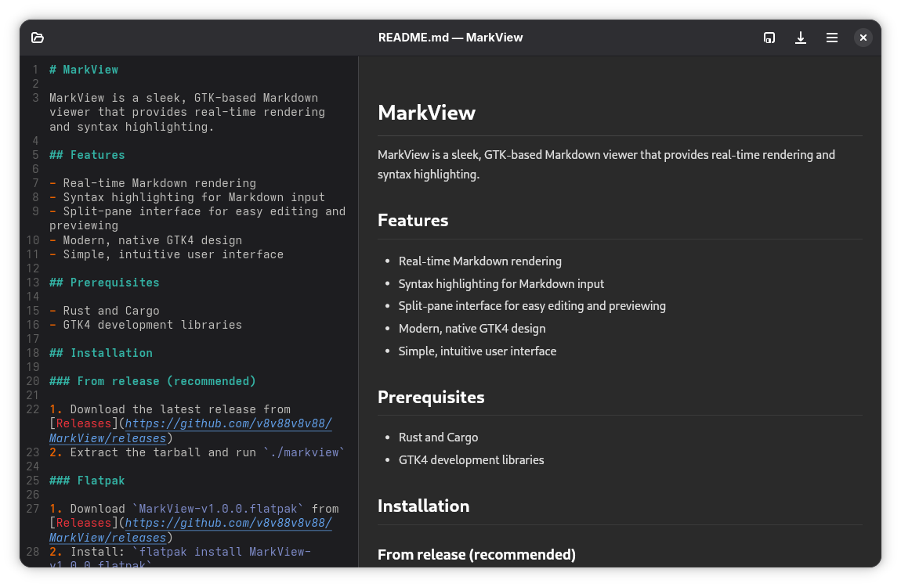

<div align="center">
  
  <h1>MarkView</h1>
  <p>A Markdown editor with a live preview, for Linux, Windows and macOS.</p>
</div>



Write Markdown on the left and see it rendered on the right as you type. Built with Rust, GTK 4 and libadwaita on every platform. The preview uses each system's own web engine: WebKitGTK on Linux, Microsoft Edge WebView2 on Windows and WebKit (WKWebView) on macOS.

## Features

- Live preview rendered by the system web engine, updated in place as you type
- Tabs with a tab overview, and a searchable list of recently opened files
- Preview follows the system accent color, document font and light/dark style
- Editor, split and preview layouts with animated switching, stacking vertically on narrow windows
- GtkSourceView editor with Markdown highlighting, 27 color schemes that switch light/dark with the system, line numbers, wrapping and optional Vim keybindings
- Find and replace with match count, case and regex options
- GitHub-style alerts (`> [!NOTE]`, `> [!WARNING]`, …), footnotes, task lists, tables, definition lists and sub/superscript
- YAML front matter can be shown, hidden or rendered as text
- Asks before closing or opening over unsaved changes
- Open files by dragging them in; links open in your browser, links to other Markdown files open in MarkView
- Export to PDF
- Every keyboard shortcut can be changed in Preferences

## Install

Download the build for your platform from the [latest release](https://github.com/V8V88V8V88/MarkView/releases/latest).

- **Linux**: install the `.flatpak` bundle, or extract the x86_64 tarball and run `./markview`. The tarball needs GTK 4.24+, libadwaita 1.10+, GtkSourceView 5.22+ and WebKitGTK 6.0 installed.
- **Windows** (x86_64): extract the zip and run `bin\markview.exe`. GTK and its libraries are included. The preview needs the [WebView2 Runtime](https://developer.microsoft.com/microsoft-edge/webview2/), which ships with Windows 10 and 11.
- **macOS** (Apple Silicon): install the libraries with [Homebrew](https://brew.sh), then extract the tarball and run `./markview`:

  ```bash
  brew install gtk4 libadwaita gtksourceview5 adwaita-icon-theme
  ```

## Build from source

You need Rust and the development packages for GTK 4.24+, libadwaita 1.10+ and GtkSourceView 5.22+. On Linux you also need WebKitGTK 6.0.

```bash
git clone https://github.com/V8V88V8V88/MarkView.git
cd MarkView
cargo run --release
```

Installing the libraries:

```bash
# Fedora
sudo dnf install gtk4-devel libadwaita-devel gtksourceview5-devel webkitgtk6.0-devel

# macOS
brew install pkgconf gtk4 libadwaita gtksourceview5 adwaita-icon-theme

# Windows, in an MSYS2 UCRT64 shell (https://www.msys2.org)
pacman -S mingw-w64-ucrt-x86_64-{gtk4,libadwaita,gtksourceview5,pkgconf,gcc,rust}
```

On Windows, `scripts/bundle-windows.sh` builds a self-contained folder and zip from the MSYS2 shell (it also needs `mingw-w64-ucrt-x86_64-ntldd` and `zip`).

## Keyboard shortcuts

On macOS, Ctrl is Cmd.

| Action | Default |
|---|---|
| New tab | Ctrl+T |
| New window | Ctrl+N |
| Open | Ctrl+O |
| Save / Save As | Ctrl+S / Ctrl+Shift+S |
| Export as PDF | Ctrl+P |
| Find and replace | Ctrl+F |
| Show or hide editor | Ctrl+E |
| Switch layout | Ctrl+L |
| Readable line length | Ctrl+R |
| Preferences | Ctrl+, |
| Keyboard shortcuts | Ctrl+? |
| Close tab / window | Ctrl+W / Ctrl+Shift+W |
| Quit | Ctrl+Q |

## License

GPL-2.0. See [LICENSE](LICENSE).
